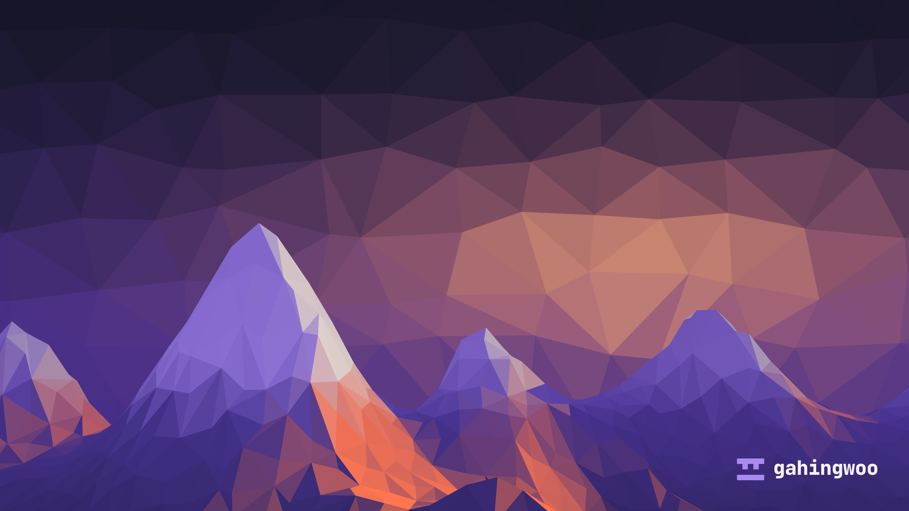
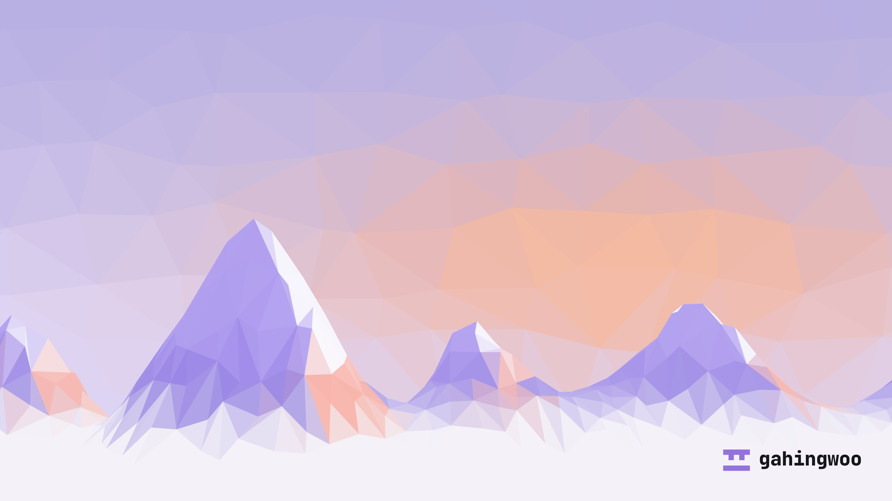

# design

Personal design assets for gahingwoo.

## wallpaper/

A low-poly ridge at first light: one world, one sun, one camera. The dark version has the
valleys pooled in shadow, and the light version has them filled with morning mist. The
`gahingwoo` mark and wordmark sit bottom-right, and they appear only once in each image.

### Preview





All six formats side by side: [all formats](wallpaper/previews/gahingwoo-ridge-r3-all-formats.png).
Light version preview: [light preview](wallpaper/previews/gahingwoo-ridge-light-preview-960.png).

### Downloads

| Format | Size | Dark | Light |
|---|---|---|---|
| Desktop 16:9 | 3840×2160 | [PNG](wallpaper/dark/gahingwoo-ridge-3840x2160-dark.png) · [@2x](wallpaper/dark/gahingwoo-ridge-3840x2160-dark@2x.png) · [SVG](wallpaper/svg/gahingwoo-ridge-3840x2160-dark.svg) | [PNG](wallpaper/light/gahingwoo-ridge-3840x2160-light.png) · [@2x](wallpaper/light/gahingwoo-ridge-3840x2160-light@2x.png) · [SVG](wallpaper/svg/gahingwoo-ridge-3840x2160-light.svg) |
| Desktop 16:10 | 3456×2160 | [PNG](wallpaper/dark/gahingwoo-ridge-3456x2160-dark.png) · [@2x](wallpaper/dark/gahingwoo-ridge-3456x2160-dark@2x.png) · [SVG](wallpaper/svg/gahingwoo-ridge-3456x2160-dark.svg) | [PNG](wallpaper/light/gahingwoo-ridge-3456x2160-light.png) · [@2x](wallpaper/light/gahingwoo-ridge-3456x2160-light@2x.png) · [SVG](wallpaper/svg/gahingwoo-ridge-3456x2160-light.svg) |
| Ultrawide | 5120×2160 | [PNG](wallpaper/dark/gahingwoo-ridge-5120x2160-dark.png) · [@2x](wallpaper/dark/gahingwoo-ridge-5120x2160-dark@2x.png) · [SVG](wallpaper/svg/gahingwoo-ridge-5120x2160-dark.svg) | [PNG](wallpaper/light/gahingwoo-ridge-5120x2160-light.png) · [@2x](wallpaper/light/gahingwoo-ridge-5120x2160-light@2x.png) · [SVG](wallpaper/svg/gahingwoo-ridge-5120x2160-light.svg) |
| Square | 2160×2160 | [PNG](wallpaper/dark/gahingwoo-ridge-2160x2160-dark.png) · [@2x](wallpaper/dark/gahingwoo-ridge-2160x2160-dark@2x.png) · [SVG](wallpaper/svg/gahingwoo-ridge-2160x2160-dark.svg) | [PNG](wallpaper/light/gahingwoo-ridge-2160x2160-light.png) · [@2x](wallpaper/light/gahingwoo-ridge-2160x2160-light@2x.png) · [SVG](wallpaper/svg/gahingwoo-ridge-2160x2160-light.svg) |
| Phone | 1290×2796 | [PNG](wallpaper/dark/gahingwoo-ridge-1290x2796-dark.png) · [@2x](wallpaper/dark/gahingwoo-ridge-1290x2796-dark@2x.png) · [SVG](wallpaper/svg/gahingwoo-ridge-1290x2796-dark.svg) | [PNG](wallpaper/light/gahingwoo-ridge-1290x2796-light.png) · [@2x](wallpaper/light/gahingwoo-ridge-1290x2796-light@2x.png) · [SVG](wallpaper/svg/gahingwoo-ridge-1290x2796-light.svg) |
| Social header | 1500×500 | [PNG](wallpaper/dark/gahingwoo-ridge-1500x500-dark.png) · [@2x](wallpaper/dark/gahingwoo-ridge-1500x500-dark@2x.png) · [SVG](wallpaper/svg/gahingwoo-ridge-1500x500-dark.svg) | [PNG](wallpaper/light/gahingwoo-ridge-1500x500-light.png) · [@2x](wallpaper/light/gahingwoo-ridge-1500x500-light@2x.png) · [SVG](wallpaper/svg/gahingwoo-ridge-1500x500-light.svg) |

`@2x` is double the listed size (for example 3840×2160 → 7680×4320). 
- [`dark/`](wallpaper/dark), [`light/`](wallpaper/light): PNGs at @1x and @2x.
- [`svg/`](wallpaper/svg): vector masters, with the font embedded. Export them at any size.
- [`previews/`](wallpaper/previews): the review trail, including rejected directions.
- [`src/`](wallpaper/src): the generator.

Each format is the same 3D scene shot again with a different focal length and principal
point. None of them is a crop.

### Rules enforced in code

Every rule is an `assert`. A framing or palette that breaks one renders nothing.

- **One focal point.** The most salient visible face is on the main summit, and the sky
  stays at or below 70% of it. Salience means luminance in the dark version and OKLab
  chroma in the light version, because in a light frame the brightest thing is the sky.
- **Signature legibility.** Measured on the rendered pixels behind the signature: the mark
  colour against every pixel must reach 3:1 or better (WCAG, for graphics), and the
  luminance spread there must stay within 0.06.
- **Coverage.** Terrain reaches the bottom and both side edges. This is checked on points
  along the bottom edge, not just on vertices.
- **Framing.** The summit top sits inside a fixed band of the frame.

### Brand constants (do not change)

| | Dark | Light |
|---|---|---|
| Purple | `#A98BF0` | `#9472DB` |
| Text | `#F4F2FA` | `#17171B` |
| Background | `#1A1928` (≈) | `#F4F2F8` (≈) |

The mark is four rectangles in a 350×280 grid: `(0,0)-(350,70)`, `(70,70)-(140,140)`,
`(210,70)-(280,140)` and `(0,210)-(350,280)`. The wordmark is JetBrains Mono ExtraBold.

In the light version, `#9472DB` on `#F4F2F8` peaks at 3.32:1, so the ground under the
signature has to be almost pure mist. That constraint is what sets `mist_lo` in
`PAL_LIGHT`.

### Regenerate

Requires Python 3 with numpy, scipy and Pillow, plus Google Chrome (headless, used as
the SVG renderer) and npm.

```sh
cd wallpaper/src
npm install                                   # JetBrains Mono, embedded into every SVG
python3 final.py 3840x2160 dark               # -> ../dark/*.png and ../svg/*.svg
python3 final.py 3840x2160 light 2            # -> ../light/*@2x.png
```

Framings live in `formats.py`, and palettes and the scene live in `ridge.py`. Output is
deterministic (seed 7): a fresh checkout reproduces the committed PNGs pixel for pixel.

## badge/

The credit badge, as light and dark SVGs: [dark](badge/gahingwoo-credit-badge-dark.svg) · [light](badge/gahingwoo-credit-badge-light.svg).

<picture>
  <source media="(prefers-color-scheme: dark)" srcset="badge/gahingwoo-credit-badge-dark.svg">
  
</picture>

Design review: DavidQyn.
